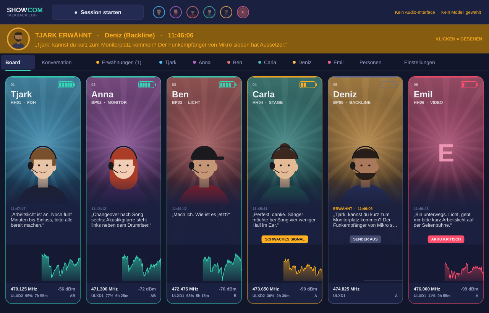
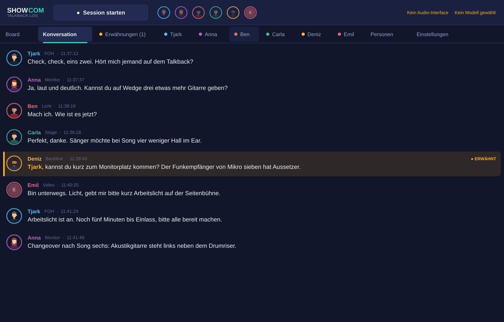

# ShowCom

**Talkback-Log für den Livesound-Betrieb** – Mitschnitt und Live-Transkription des Talkbacks, für Windows (ASIO) und macOS (CoreAudio).



- **Board im RF-Board-Stil**: Pro Person eine hohe Kachel mit Foto, Lichtstrahlen in ihrer Farbe, Akku oben rechts, letzter Ansage, Verlauf von HF-Signal und Talkback-Pegel sowie Frequenz, Restlaufzeit und dBm. Warnungen wie *Akku kritisch*, *Akku niedrig*, *Schwaches Signal* oder *Sender aus* erscheinen direkt auf der Kachel.
- **Funkempfänger im Netzwerk**: Shure ULX-D, QLX-D, SLX-D und Axient Digital (TCP 2202) sowie Sennheiser EW-DX EM 2/EM 4 (SSCv1, UDP 45). Jeder Person wird ihr Funkkanal zugewiesen.
- **Eine Person pro Eingang**: Jedes Talkback-Mikro liegt auf einem eigenen Kanal des Audio-Interfaces. Dadurch ist immer eindeutig, wer gesprochen hat – ohne fehleranfällige Stimmerkennung.
- **Benutzer mit Avataren**: Name, Funktion (FOH, Monitor, Licht …), Farbe, Profilbild (Klick oder Drag & Drop), Eingang und Sprach-Schwelle mit Live-Pegel.
- **Tabs**: *Konversation* (alle chronologisch), *Erwähnungen*, ein Tab pro Person, *Personen*, *Einstellungen*.
- **Namens-Alarm**: Dein Name (plus Varianten) wird in jedem Transkript gesucht – ohne Groß/klein, mit Umlaut-Faltung und optional unscharf („Tjarck“ → „Tjark“). Bei einem Treffer blinkt oben ein großes Banner, der Beitrag wird markiert, ein Klick springt hin.
- **Lokal & offline**: Spracherkennung mit [whisper.cpp](https://github.com/ggml-org/whisper.cpp), auf dem Mac per GPU (Metal). Kein Internet am Venue nötig, keine Daten in der Cloud.
- **Mitschnitt**: Pro Person eine WAV-Datei (24 Bit mono) plus `transcript.txt` (wird live geschrieben) und `transcript.json` mit Zeitstempeln, die auf die Position in der WAV-Datei zeigen.
- **Sicher am Pult**: Die Software öffnet das Interface nur mit Eingängen und gibt nie Audio aus.

## Aufbau

```
Audio-Interface (ASIO / CoreAudio)
   │  Audio-Callback (Echtzeit): kopiert nur in lock-freie FIFOs, misst Pegel
   ▼
AudioEngine – Verarbeitungs-Thread
   │  pro Person: Sprach-Gate (Pre-Roll 300 ms, Nachlauf 700 ms, max. 25 s) + WAV-Writer
   ▼
Transcriber – eigener Thread, whisper.cpp
   │  48 kHz → 16 kHz, Pegel anheben, Halluzinationen filtern, Namen als Prompt
   ▼
TranscriptModel → Namenssuche (KeywordMatcher) → GUI (JUCE)
```

| Datei | Aufgabe |
|---|---|
| `src/AudioEngine.*` | Gerät, Echtzeit-Callback, FIFOs, Pegel, Segmentierung, WAV-Mitschnitt |
| `src/core/SpeechSegmenter.*` | Sprach-Gate (reines C++, getestet) |
| `src/core/KeywordMatcher.*` | Namenssuche (reines C++, getestet) |
| `src/Transcriber.*` | whisper.cpp-Anbindung, Resampling, Filter, Modell-Laden |
| `src/TranscriptModel.*` | Einträge, Erwähnungen, Protokolldateien |
| `src/AppState.*` | Benutzer, Avatare, Einstellungen (JSON) |
| `src/AppController.*` | Verdrahtung, Sessions |
| `src/ui/*` | Oberfläche |

| Konversation | Personen |
|---|---|
|  |  |

## Bauen

Voraussetzungen: CMake ≥ 3.22, Git. JUCE 8.0.9 und whisper.cpp 1.9.5 lädt CMake beim ersten Konfigurieren selbst herunter.

### Windows (mit ASIO)

1. **Visual Studio 2022** (Workload „Desktopentwicklung mit C++“) und **CMake** installieren.
2. **ASIO SDK** von Steinberg laden: <https://www.steinberg.net/developers/> (seit Oktober 2025 auch unter GPLv3 verfügbar) und entpacken, z. B. nach `C:\SDKs\asiosdk`. Der Ordner muss `common\iasiodrv.h` enthalten.
3. In der „Developer PowerShell for VS 2022“:

```powershell
cmake -S . -B build -G "Visual Studio 17 2022" -A x64 -DTBS_ASIO_SDK_DIR="C:\SDKs\asiosdk"
cmake --build build --config Release --parallel
```

Das Programm liegt danach unter `build\ShowCom_artefacts\Release\ShowCom.exe`.

**GPU unter Windows (optional, deutlich schneller):**
- NVIDIA: CUDA Toolkit installieren und zusätzlich `-DGGML_CUDA=ON` angeben.
- AMD/Intel/NVIDIA: Vulkan SDK installieren und `-DGGML_VULKAN=ON` angeben.

Ohne GPU läuft alles auf der CPU. Auf einem aktuellen 8-Kerner reicht das für `large-v3-turbo q5` im Talkback-Betrieb (kurze Sätze) meist aus.

### macOS

Xcode bzw. die Command Line Tools und CMake (`brew install cmake`) installieren, dann:

```bash
cmake -S . -B build -DCMAKE_BUILD_TYPE=Release
cmake --build build --config Release --parallel
open "build/ShowCom_artefacts/Release/ShowCom.app"
```

Metal (GPU) ist automatisch aktiv. Beim ersten Start fragt macOS nach dem Mikrofon-Zugriff – erlauben, sonst kommen nur Nullen an.

### Automatisch über GitHub

Das Repository enthält `.github/workflows/build.yml`. Nach einem Push auf GitHub baut GitHub Actions automatisch:
- **Windows** mit ASIO (das SDK wird mit Prüfsumme geladen),
- **macOS** für Apple Silicon (ad-hoc signiert).

Die fertigen Programme liegen unter *Actions → letzter Lauf → Artifacts*: `ShowCom-Windows.exe` und `ShowCom-macOS.dmg`. Nach jedem erfolgreichen Build auf `main` stehen beide außerdem unter *Releases* zum Download (Version aus `CMakeLists.txt`). Da die Mac-App nicht notarisiert ist: beim ersten Öffnen Rechtsklick → *Öffnen*, oder `xattr -dr com.apple.quarantine "ShowCom.app"`.

### Tests

```bash
ctest --test-dir build -C Release --output-on-failure
```

- `core`: Namenssuche (Umlaute, Mehrwort-Namen, Genitiv, unscharf) und Sprach-Gate.
- `core` prüft außerdem den Shure-Parser mit Antworten von ULX-D, SLX-D und Axient Digital.
- `engine`: Die komplette Audio-Engine mit einem simulierten 8-Kanal-Interface – automatische Kanal-Aktivierung, Schnitt, Zeitstempel, WAV-Inhalt – sowie die Netzwerk-Clients gegen einen simulierten Shure-ULX-D- und Sennheiser-EW-DX-Empfänger.

## Erste Schritte

1. **Einstellungen → Spracherkennung**: Modell wählen und *Herunterladen*. Empfohlen: `large-v3-turbo q5` (574 MB, gute Qualität bei Deutsch). Auf schwachen Rechnern `small`. Sprache: Deutsch.
2. **Einstellungen → Audio-Interface**: unter Windows Typ **ASIO** und dein Interface wählen, unter macOS das CoreAudio-Gerät.
3. **Personen**: Für jede Person *+ Person*, Name, Funktion, Avatar, **Eingang** wählen. Die **Sprach-Schwelle** (gelber Strich) knapp über das Grundrauschen bzw. Bühnen-Übersprechen stellen – der Pegelbalken zeigt live, ob Sprache erkannt wird.
4. **Einstellungen → Mein Name**: deinen Namen und Varianten eintragen, z. B. `Tjark, Tjarki, Monitor-Tjark`. Mit *Alarm testen* prüfen.
5. Oben **Session starten**. Mitschnitte landen in `Dokumente/ShowCom/<Datum_Uhrzeit>/`.

Zum Ausprobieren ohne Interface und ohne Funk: Programm mit `--demo` starten. Das füllt die Anzeige mit Beispiel-Talkback und simuliert sechs Funkstrecken (wenn Personen angelegt sind).

## Funkempfänger anbinden

Unter **Einstellungen → Funkempfänger** jeden Empfänger mit Typ und IP-Adresse eintragen (optional mit Port, z. B. `192.168.1.50:2202`). Der Status-Punkt wird grün, sobald Daten kommen. Danach unter **Personen → Funkstrecke** den passenden Kanal wählen – die Liste zeigt die Kanalnamen, die am Empfänger eingestellt sind.

| Hersteller | Geräte | Protokoll | Am Gerät einstellen |
|---|---|---|---|
| Shure | ULX-D, QLX-D, SLX-D, Axient Digital | TCP 2202, ASCII-Befehle | nichts (Standard). Rechner und Empfänger im selben Netz. |
| Sennheiser | EW-DX EM 2, EM 2 Dante, EM 4 Dante | Sound Control Protocol v1, JSON über UDP 45 | Drittanbieter-Zugriff **„Legacy (SSCv1)“** aktivieren (Control Cockpit → Gerät → *Access*) |

Angezeigt werden – je nachdem, was das Gerät liefert – Akku in % bzw. Balken, Restlaufzeit, Frequenz, HF-Pegel (Shure, dBm) bzw. Signalqualität (Sennheiser, %), aktive Antenne, Sendertyp, Stummschaltung und ob der Sender an ist. ShowCom fragt nur ab; es ändert keine Einstellungen am Empfänger (einzige Ausnahme: bei Shure wird die Meter-Rate auf 1 s gesetzt, damit der Pegelverlauf läuft).

Hinweis: Das neuere, verschlüsselte SSCv2 der EW-DX (HTTPS mit Passwort) ist noch nicht eingebaut; dafür bitte vorerst SSCv1 aktivieren.


## Praxis-Tipps

- **Signal abgreifen**: Talkback-Mikros vor dem Talkback-Bus abgreifen (Direct Out, Split, Dante/AVB-Stream) und einzeln auf das Interface legen. Ein Summen-Talkback funktioniert technisch auch, dann ist aber nur eine „Person“ erkennbar.
- **ASIO ist meist Single-Client**: Läuft auf demselben Interface schon eine DAW für den Show-Mitschnitt, kann ShowCom es oft nicht gleichzeitig öffnen. Lösungen: ein separates kleines Interface, ein Multi-Client-Treiber oder ein eigener Dante-/AVB-Kanal für diesen Rechner.
- **Zugewiesene Eingänge** werden automatisch am Interface aktiviert.
- **Whisper-Eigenheiten**: In Stille oder Rauschen erfindet Whisper gern Floskeln („Untertitel im Auftrag des ZDF“). Die bekannten werden herausgefiltert, und das Sprach-Gate schickt nur echte Sprache zur Erkennung. Wenn trotzdem Unsinn erscheint: Schwelle der betreffenden Person anheben.
- **Namen richtig schreiben**: Alle Personennamen und deine Namen werden der Erkennung als Kontext mitgegeben, das verbessert die Schreibweise deutlich.

## Daten

| Was | Wo |
|---|---|
| Einstellungen, Personen | Windows: `%APPDATA%\ShowCom\settings.json` · macOS: `~/Library/Application Support/ShowCom/` |
| Avatare (auf 256 × 256 px zugeschnitten) | `…/ShowCom/avatars/` |
| Modelle | `…/ShowCom/models/` |
| Mitschnitte | `Dokumente/ShowCom/` (änderbar) |

## Nächste Ausbaustufen

- Beitrag anklicken → Ausschnitt aus der WAV vorhören (über ein separates Ausgabegerät, nie über das Pult)
- Ältere Sessions laden und durchsuchen, Suche im Transkript
- Optionaler Ton oder Push-Benachrichtigung aufs Handy bei Erwähnung
- Stimmerkennung (Diarisierung) für Summen-Talkback

## Lizenzen

- **JUCE 8**: AGPLv3 oder kommerzielle JUCE-Lizenz. Für eigene/interne Nutzung problemlos; wer das Programm weitergibt, muss AGPLv3 einhalten oder eine JUCE-Lizenz haben.
- **whisper.cpp / ggml**: MIT. Whisper-Modelle: MIT (OpenAI).
- **Steinberg ASIO SDK**: GPLv3 oder proprietäre Steinberg-Lizenz. Das SDK liegt nicht im Repository, sondern wird beim Bauen eingebunden.
